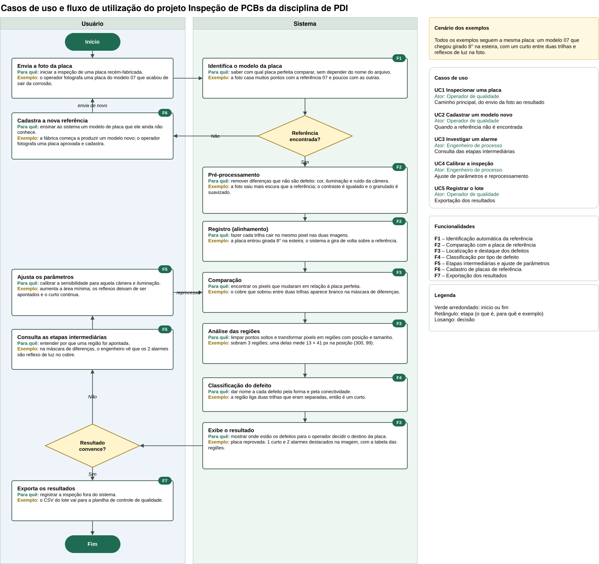

# Inspeção de PCB por Processamento Digital de Imagens

**Detecção e Caracterização Automática de Defeitos em Placas de Circuito Impresso por Processamento Digital de Imagens**

Trabalho final da disciplina de **Processamento Digital de Imagens** (turma QUA-SEX 10:00-12:00), UFC, 2026.2.

**Professor:** [Paulo Cesar Cortez](http://www.si3.ufc.br/site/cortez.paulo.cesar)

## Equipe

| Nome | Matrícula | Responsabilidade |
|---|---|---|
| Breno Fernandes Barbosa de Sousa | 520394 | Funcionalidades e integração: definição das funcionalidades e do fluxo de utilização, janela principal que integra as abas, organização do repositório e README |
| Bruno Nascimento Brasilino de Freitas | 511399 | Dataset e referências: escolha do dataset, análise inicial (estrutura, quantidade de imagens por tipo de defeito, formato das anotações) e tela de cadastro de placas de referência |
| Danilo Bezerra Vieira | 554767 | Tela de inspeção: carregamento da placa de referência e da testada lado a lado, componentes de visualização compartilhados e ponto de integração do registro (alinhamento) |
| Francisco Vinicius Castro Silveira | 553889 | Tela de etapas: acompanhamento das etapas do processamento e dos parâmetros ajustáveis (limiar, tamanho do kernel, área mínima), com a versão inicial do processamento (diferença entre imagens, limiarização e operações morfológicas) |
| Nataniel Marques Viana Neto | 554664 | Tela de resultados: destaque visual dos defeitos, resumo da análise, tabela das regiões detectadas, exportação em CSV e estrutura reservada para as métricas de avaliação |

## Motivação

Placas de circuito impresso estão em praticamente todo equipamento eletrônico, e defeitos de fabricação como curtos, trilhas interrompidas e cobre em excesso comprometem o funcionamento do produto. Quanto mais cedo o defeito é encontrado, menor o custo de correção. A inspeção humana é lenta e sujeita a erros. Sistemas de inspeção automática são especialmente necessários em fábricas pequenas e produtores locais, que querem entregar qualidade semelhante à das grandes empresas sem pagar por sistemas caros e sem repassar um preço alto aos consumidores.

## Objetivo

Desenvolver um sistema de inspeção visual capaz de localizar alterações entre uma placa eletrônica de referência e outra sob teste, com interface gráfica para acompanhar cada etapa do processamento e ajustar seus parâmetros. A comparação de pixels deve ser acelerada em GPU.

**Estado atual:** protótipo funcional em Python (OpenCV e NumPy), com interface completa. A aceleração em GPU com CUDA é o próximo passo.

## Como funciona

O usuário carrega a foto de uma placa recém-fabricada. O sistema identifica sozinho qual placa de referência usar, alinha as duas imagens (a placa pode chegar girada), compara pixel a pixel, limpa o resultado e mostra as regiões candidatas a defeito. Se o resultado não convence, o usuário consulta as etapas intermediárias, ajusta os parâmetros e reprocessa sem precisar alinhar de novo. Por fim, exporta a tabela de regiões em CSV.

Fluxo completo, com exemplos de cada etapa: [`docs/fluxograma.svg`](docs/fluxograma.svg)



### Funcionalidades

| Código | Funcionalidade | Onde está | Situação |
|---|---|---|---|
| F1 | Identificação automática da referência | aba Inspeção, `registro.py` | implementada |
| F2 | Comparação com a placa de referência (pré-processamento e registro/alinhamento) | `pipeline.py`, `registro.py` | implementada |
| F3 | Localização e destaque dos defeitos | `pipeline.py`, aba Resultados | implementada |
| F4 | Classificação por tipo de defeito | `pipeline.py` | **pendente** (as regiões saem como "não classificado") |
| F5 | Etapas intermediárias e ajuste de parâmetros | aba Etapas | implementada |
| F6 | Cadastro de placas de referência | aba Referências | implementada |
| F7 | Exportação dos resultados em CSV | aba Resultados | implementada |

As métricas contra as anotações (precisão, revocação, F1 e falsos positivos) têm lugar reservado na aba Resultados e serão preenchidas quando a avaliação for implementada.

### Casos de uso

| Código | Caso de uso | Ator |
|---|---|---|
| UC1 | Inspecionar uma placa | Operador de qualidade |
| UC2 | Cadastrar um modelo novo (quando a referência não é encontrada) | Operador de qualidade |
| UC3 | Investigar um alarme (consultar as etapas intermediárias) | Engenheiro de processo |
| UC4 | Calibrar a inspeção (ajustar parâmetros e reprocessar) | Engenheiro de processo |
| UC5 | Registrar o lote (exportar os resultados) | Operador de qualidade |

## Interface

A janela principal (`scripts/src/interface/janela_principal.py`) reúne quatro abas e faz a comunicação entre elas:

| Aba | Para que serve |
|---|---|
| **Inspeção** | Carrega a placa testada, identifica a referência e mostra as duas lado a lado. Dispara a inspeção. |
| **Etapas** | Mostra cada etapa do processamento e os parâmetros ajustáveis (limiar, kernel, área mínima). |
| **Resultados** | Mostra os defeitos destacados, o resumo da análise, a tabela de regiões e exporta o CSV. |
| **Referências** | Lista, importa (do `PCB_USED` do dataset), cadastra e remove placas de referência. |

Comunicação entre as telas:

```text
Referências --(lista de placas)--> Inspeção
Inspeção --(referência, testada)--> janela principal --> pipeline --> Etapas e Resultados
Inspeção --("referência não encontrada")--> abre a aba Referências
Etapas --(parâmetros mudaram)--> janela principal --> reprocessa sem alinhar de novo
```

O alinhamento é calculado uma vez por par de imagens e reaproveitado quando só os parâmetros mudam, o que deixa o ajuste fino rápido.

## Como executar

Requisitos: [uv](https://docs.astral.sh/uv/) instalado.

```bash
git clone https://github.com/NatanielMarques14/inspecao-pcb-pdi.git
cd inspecao-pcb-pdi
uv sync
uv run python main.py
```

Rode sempre a partir da raiz do projeto. Para a análise do dataset (gera a pasta `resultados/analise_dataset/`):

```bash
uv run python scripts/analise_dataset.py
```

## Estrutura do repositório

```text
inspecao-pcb-pdi/
├── main.py                      # ponto de entrada da aplicação
├── pyproject.toml               # dependências (gerenciadas com uv)
├── uv.lock
├── dados/
│   ├── README.md                # estrutura e observações sobre o dataset
│   └── referencias/             # placas de referência cadastradas (local)
├── docs/
│   ├── fluxograma.svg           # casos de uso e fluxo de utilização
│   └── PENDENCIAS.md            # itens em aberto do repositório
├── resultados/                  # gerada ao rodar a análise do dataset
│   └── analise_dataset/
└── scripts/
    ├── analise_dataset.py       # análise inicial do dataset
    └── src/
        ├── interface/           # telas (PySide6)
        │   ├── janela_principal.py
        │   ├── aba_inspecao.py
        │   ├── aba_etapas.py
        │   ├── aba_resultados.py
        │   ├── aba_referencias.py
        │   └── componentes.py   # componentes de visualização compartilhados
        └── processamento/
            ├── pipeline.py      # alinhamento, comparação e análise de regiões
            └── registro.py      # identificação da referência e registro
```

## Dados

O sistema utiliza o dataset **PKU-Market-PCB**, da Universidade de Pequim, disponível em [robotics.pkusz.edu.cn/resources/dataset](https://robotics.pkusz.edu.cn/resources/dataset/). São 693 imagens de placas com defeitos inseridos digitalmente, em seis tipos (Missing hole, Mouse bite, Open circuit, Short, Spur e Spurious copper), e 10 imagens de placas de referência (`PCB_USED`). Foi feita uma análise inicial dos dados, com estrutura, quantidade de imagens por tipo de defeito e formato das anotações.

O dataset não é versionado por causa do tamanho. Estrutura, quantidades e observações estão em [`dados/README.md`](dados/README.md).

## Tecnologias

Python, OpenCV, NumPy, Matplotlib e PySide6 (interface). CUDA para aceleração em GPU está planejado.

## Resultados

Em uma execução de demonstração com a imagem `01_missing_hole_01.jpg`, o sistema identificou a placa de referência 01 automaticamente e encontrou 3 regiões candidatas a defeito em cerca de 257 ms.

A avaliação quantitativa contra as anotações do dataset (precisão, revocação e F1) e a classificação por tipo de defeito ainda estão em desenvolvimento.
